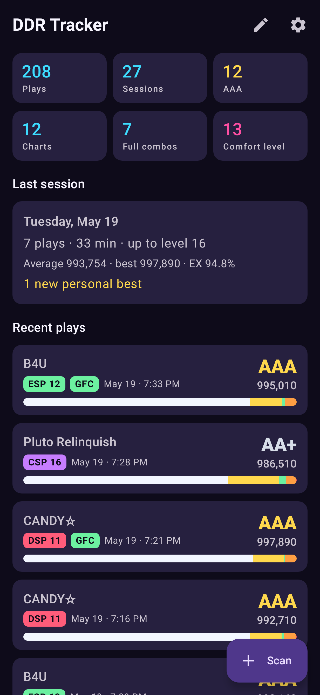
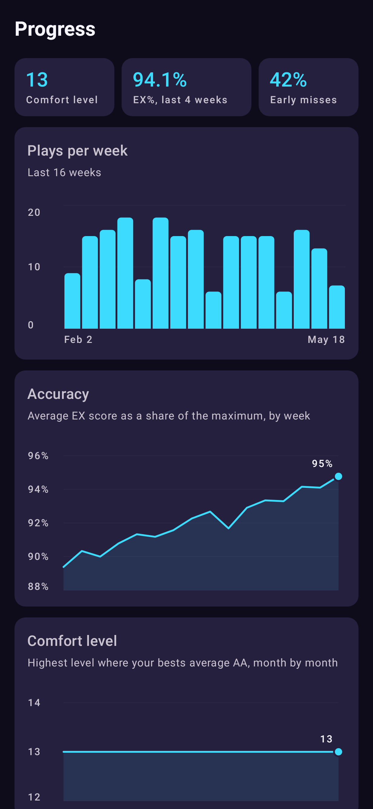
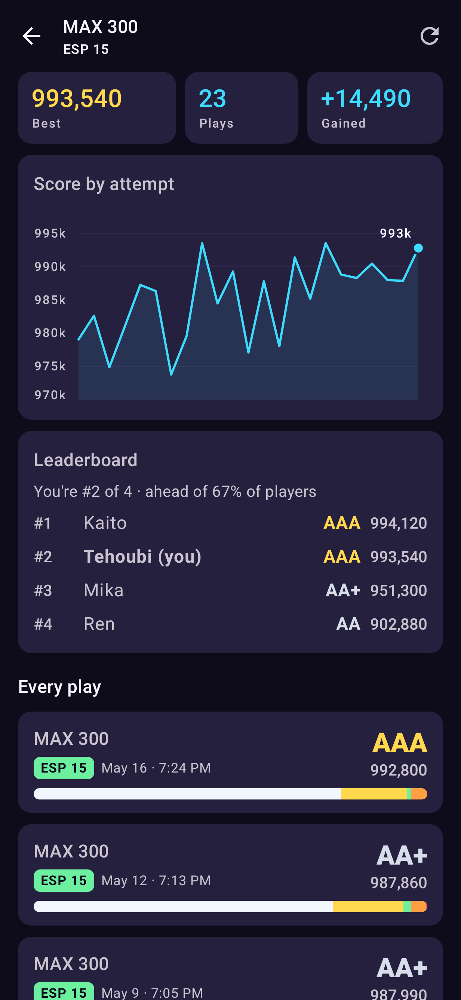
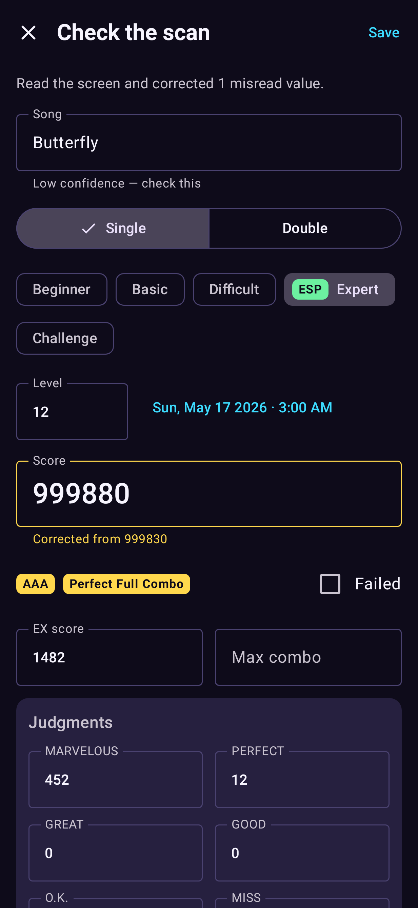
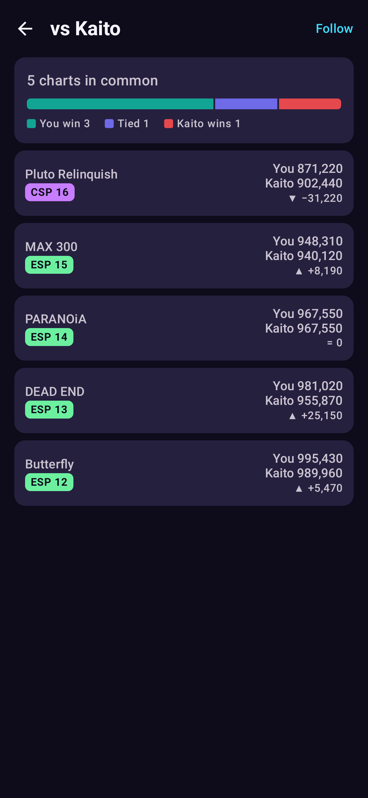
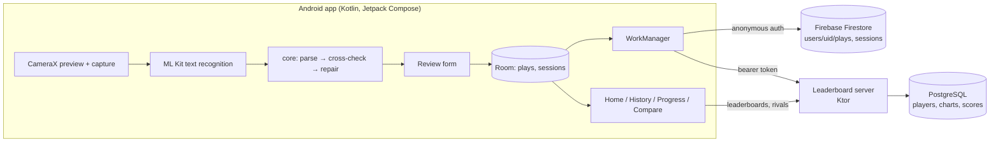

# DDR Performance Tracker

An Android app that reads Dance Dance Revolution result screens with the
phone camera, logs every play, tracks progress across sessions, and
compares scores with other players.

Point the camera at the cabinet after a song. The app reads the screen
live, frame by frame, and takes a photo once the score and judgments agree
across frames. It checks the numbers against DDR's scoring rules and fixes
single-digit misreads. You confirm, and the play is saved.

| Home | Progress | Chart + leaderboard | Scan review | Rival |
|---|---|---|---|---|
|  |  |  |  |  |

*(Rendered by the screenshot tests with sample data.)*

## Features

- **Scan result screens.** Uses CameraX with on-device ML Kit OCR, so
  nothing leaves the phone. Each preview frame gets a blur, glare and
  exposure check, and readings are voted on across frames. The photo is
  taken automatically once score and judgments settle. Screenshots can
  also be imported from the gallery.
- **Check and repair scans.** EX score and money score are both computed
  from the judgments, so a misread digit shows up as a contradiction. The
  app tries the usual OCR digit confusions (5/8, 0/8, 3/8, 1/7, …) and
  applies a fix only when exactly one explains the screen. Grade and lamp
  are derived from the numbers rather than read.
- **Two-player screens.** If both tables are visible, the parser splits
  the screen and reads your side (auto, 1P or 2P).
- **History.** Search and filter by style, difficulty, level, full combo
  and personal bests. Plays are grouped into sessions (a break of more
  than 45 minutes starts a new one).
- **Progress.** Plays per week, weekly EX%, "comfort level" (the highest
  level where your bests average AA) month by month, best clear per level,
  FAST/SLOW bias, and score by attempt for each chart.
- **Compare.** Chart leaderboards with your rank and the share of players
  you beat. Head-to-head against rivals on shared charts. Most-played
  charts.
- **Cloud backup.** Firebase Auth (anonymous) and Firestore keep a copy of
  plays and sessions and restore them on a new phone.
- **Your data.** CSV export, plus JSON backup and restore through the
  system file picker.

## How it fits together



Three Gradle modules:

| Module | What it is |
|---|---|
| `:core` | Plain Kotlin, no Android types: DDR scoring rules, the OCR result parser, scan validation and repair, frame-quality checks, multi-frame voting, song catalog and matching, sessions and progress statistics, and the leaderboard API models. Unit-tested on the JVM. |
| `:app` | The Android app: Compose UI, CameraX, ML Kit, Room, DataStore, Hilt, WorkManager, Firebase, OkHttp. |
| `:server` | The leaderboard service: Ktor, PostgreSQL through HikariCP and plain SQL, Flyway migrations. |

Room is the source of truth on the phone. Firestore is a per-player
backup. PostgreSQL holds the shared data that Firestore handles poorly:
ranking every player's best on a chart (`RANK()` / `PERCENT_RANK()`
window functions over a `DISTINCT ON` personal-bests view) and joining two
players' bests for head-to-heads.

### The scan pipeline

1. **Frame quality** (`core/vision/FrameQuality`). Computed on the Y plane:
   variance of a Laplacian normalised by contrast for sharpness, judged
   against the sharpest recent frame (a usable absolute threshold depends
   on the scene); the share of blown-out pixels for glare; mean luminance
   for exposure. These set hints and vote weights and never block a frame.
2. **OCR.** ML Kit's bundled Latin model on the 720p analysis stream at
   about 3 fps, then on the full-resolution still.
3. **Parse** (`core/ocr/ResultScreenParser`). Works on geometry, not plain
   text. Labels are fuzzy matched (with letter/digit look-alikes folded),
   and each value is the number on the same row to the right of its label.
   Separators split across elements are rejoined. Titles are matched
   against a bundled catalog plus your own songs, including titles that
   wrap onto two lines.
4. **Vote** (`core/vision/FieldConsensus`). A confidence-weighted mode per
   field over the last eight frames. It locks when the score and all six
   judgments have three agreeing frames with a 60% majority.
5. **Second pass.** If the still is inconsistent, it is OCR'd again in
   contrast-stretched grayscale (`OcrEnhance`) and the two readings are
   merged.
6. **Cross-check and repair** (`core/ocr/ScanValidator`). EX must equal
   3·Marvelous + 2·Perfect + Great + 3·O.K. The money score must follow
   from the judgments for some number of dropped freezes (DDR's SN2
   formula, in integer arithmetic). Scores end in 0.

## Data model

**Room** (`app/schemas` holds every version; migrations 1→2→3→4 are
tested against the exported schemas):

- `plays`: one row per play. Includes judgments, FAST/SLOW, lamp and
  grade, source and scan confidence. Also two outbox columns,
  `leaderboard_status` and `cloud_dirty`, with deletions kept as
  tombstones until they've synced.
- `sessions`: derived, regrouped on every write so back-dated or deleted
  plays keep sessions right.
- `user_songs`: titles you saved that aren't in the bundled catalog.

**Firestore** (rules in `firebase/firestore.rules`; each user can only
reach their own tree):

```
users/{uid}                       displayName, playCount, updatedAt
users/{uid}/plays/{playId}        flat play document + updatedAt + deleted
users/{uid}/sessions/{sessionId}  startedAt, endedAt, playCount, averageScore, bestScore, averageExRatio, ...
```

Sync pushes dirty rows in batches of 400 and pulls rows newer than a
high-water mark. Last writer wins by `updatedAt`.

**PostgreSQL** (`server/src/main/resources/db/migration`): `players`,
`api_tokens` (SHA-256 of the token only), `charts` (keyed by the same
`SongKey` slug the app uses), `scores` (unique per player and client id,
so retries and edits are idempotent), and the `personal_bests` view.

## Building

Requirements: JDK 17 and the Android SDK (platform 35). The Gradle wrapper
handles the rest.

```bash
./gradlew :app:assembleDebug        # app/build/outputs/apk/debug/app-debug.apk
./gradlew test                      # core, app (Robolectric) and server suites
./gradlew :app:verifyRoborazziDebug # screenshot tests (recordRoborazziDebug to update)
```

The APK installs on Android 8.0+ (API 26). Scanning, history, progress,
backup and restore all work with no server or Firebase project.

### Firebase (optional)

1. Create a Firebase project, add an Android app with package
   `com.tehoubi.ddrtracker`, and enable **Anonymous** sign-in and
   **Cloud Firestore**.
2. Put the downloaded `google-services.json` in `app/` (it's gitignored).
3. `firebase deploy --only firestore` to install the rules.
4. Rebuild. Settings → Cloud backup now offers the switch.

Without `google-services.json` the Google Services plugin isn't applied,
and the app says the build has no Firebase project.

### Leaderboard server (optional)

No install needed (embedded PostgreSQL):

```bash
./gradlew :server:runDev --args="--seed-demo"   # demo-* players to compare against
```

With Docker:

```bash
docker compose up -d        # PostgreSQL 16 + the server on :8080
```

Then in the app: Settings → Leaderboard → `http://<your computer's LAN IP>:8080`
→ Test → Sign up. Use `http://10.0.2.2:8080` from an emulator. Plain HTTP is
allowed because servers are usually on a home network; use `https://` if
yours has a certificate.

| Method | Path | Notes |
|---|---|---|
| GET | `/health` | Database reachability |
| POST | `/v1/players` | Register `{displayName}` → `{playerId, token}`. Rate limited. |
| GET/PATCH | `/v1/players/me` | Profile with totals; rename |
| GET | `/v1/players/search?q=` | Find rivals |
| GET | `/v1/players/{id}` | Public profile |
| POST | `/v1/scores` | Up to 500 plays. Validated with the same rules as the app, grade and lamp recomputed, a reason per rejected play |
| DELETE | `/v1/scores/{clientId}` | Mirror a deletion |
| GET | `/v1/charts/{songKey}/{style}/{difficulty}/leaderboard` | Ranked bests, plus your row and percentile when authenticated |
| GET | `/v1/players/{id\|me}/compare/{rival}` | Wins, losses and ties on shared charts |
| GET | `/v1/charts/popular` | Most-played charts |

Server configuration comes from the environment: `DATABASE_URL`,
`DATABASE_USER`, `DATABASE_PASSWORD`, `PORT`, `DATABASE_POOL_SIZE` and
`REGISTRATIONS_PER_HOUR` (see `.env.example`).

## Trying it without a cabinet

`samples/` has synthetic result screens (drawn in the A3/WORLD layout, not
game captures) for **Scan → From gallery**. `sample-backup.json` holds
about three months of plays for **Settings → Restore from a file**.
`tools/make_samples.py` regenerates both.

## Tests

- `core`: scoring formula and grade boundaries, the parser (misspelled
  labels, look-alike digits, split separators, lamp text, two-player
  screens, wrapped titles), repair, frame quality, frame voting, sessions
  and statistics, and submission rules.
- `app`: Room repository and session grouping, migrations, leaderboard
  upload against MockWebServer (including the edit-during-upload race),
  the HTTP client, review-form validation, filters, Firestore document
  mapping, backup round-trips, and the sample backup. Plus Roborazzi
  screenshots of every screen.
- `server`: every endpoint against a real PostgreSQL through
  embedded-postgres, including ranking ties, idempotent resubmission,
  auth and rate limiting.

CI (`.github/workflows/ci.yml`) runs all three suites, verifies the
screenshots, uploads the debug APK and builds the server image.

## Limitations

- OCR targets the A20 PLUS / A3 / WORLD result layout and Latin-script
  titles. Japanese-only titles need to be typed (they still get a stable
  chart key).
- The result screen doesn't show N.G. (dropped freezes). The validator
  infers them from the score, but a scan can over-report a full combo on
  charts with freezes when the score check is inconclusive.
- Leaderboard identity is a token stored on the phone. There's no
  password recovery: signing out on a server you don't own loses that
  account.

## License

MIT
