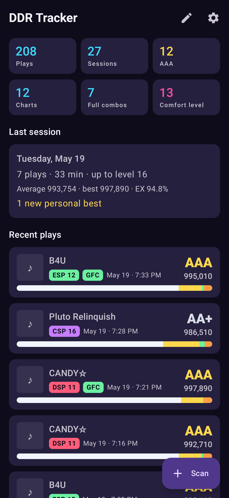
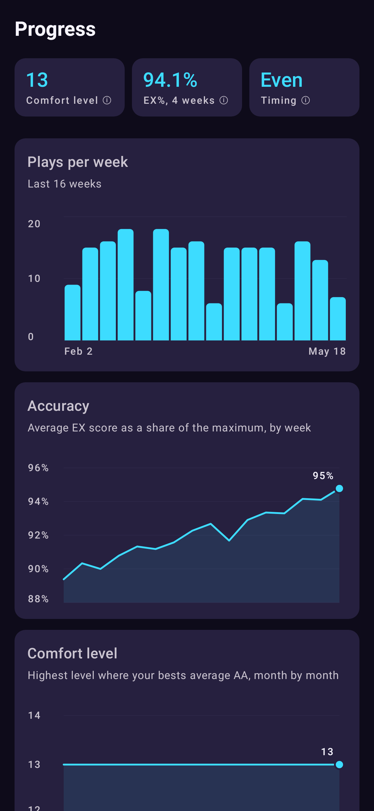
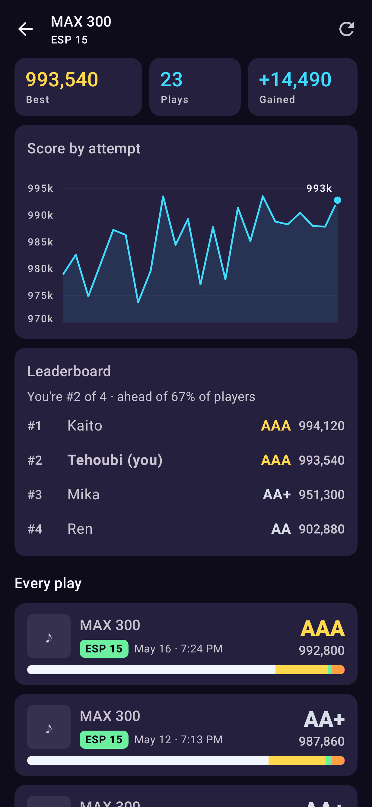
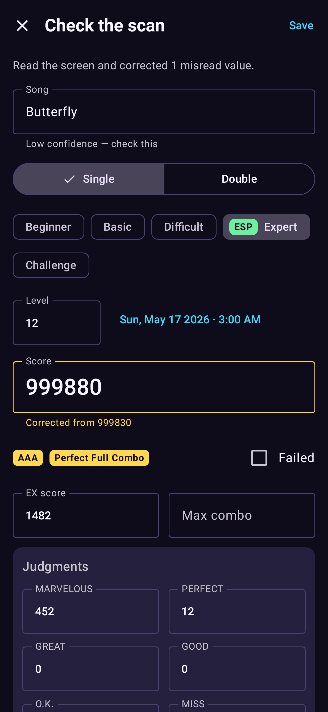
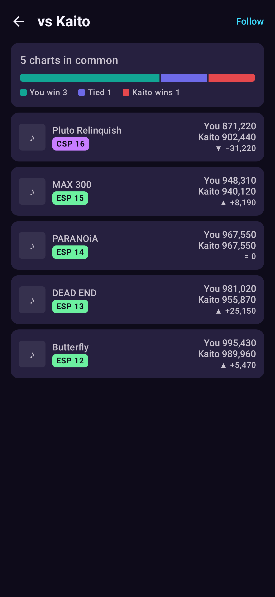
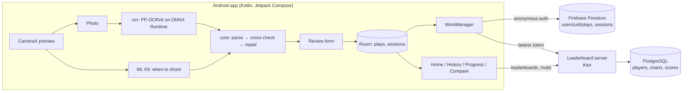

# DDR Performance Tracker

**Hosting notice:** I am no longer hosting servers for this app. Instructions
for running your own server are below in [Leaderboard server (optional)](#leaderboard-server-optional).

An Android app that reads Dance Dance Revolution result screens with the
phone camera, logs every play, tracks progress across sessions, and
compares scores with other players.

Point the camera at the cabinet after a song. The app reads the screen
live, frame by frame, and takes a photo once the score and judgments agree
across frames. It checks the numbers against DDR's scoring rules and fixes
single-digit misreads. You confirm, and the play is saved.

| Home | Progress | Chart + leaderboard | Scan review | Rival |
|---|---|---|---|---|
|  |  |  |  |  |

*(Rendered by the screenshot tests with sample data.)*

## Features

- **Scan result screens.** Uses CameraX and on-device OCR, so nothing
  leaves the phone. The photo is read with PaddleOCR's PP-OCRv6 models on
  ONNX Runtime, which read Japanese titles (kana and kanji) as well as
  Latin. While you line up the shot, ML Kit watches the preview: each frame
  gets a blur, glare and exposure check, and the photo is taken
  automatically once score and judgments settle. Screenshots can also be
  imported from the gallery.
- **Check and repair scans.** EX score and money score are both computed
  from the judgments, so a misread digit shows up as a contradiction. The
  app tries the usual OCR digit confusions (5/8, 0/8, 3/8, 1/7, …) and
  applies a fix only when exactly one explains the screen. Grade and lamp
  are derived from the numbers rather than read.
- **Two-player screens.** If both tables are visible, the parser splits
  the screen and reads your side (auto, 1P or 2P).
- **History.** Search and filter by style, difficulty, level, full combo
  and personal bests. Plays are grouped into sessions (a break of more
  than 45 minutes starts a new one).
- **Progress.** Plays per week, weekly EX%, "comfort level" (the highest
  level where your bests average AA) month by month, best clear per level,
  and score by attempt for each chart. Tap a number to see what it means.
- **Timing.** FAST/SLOW over your last 10 plays. When it leans 65/35 or
  more one way (over at least 40 timing errors), the home page says so and
  suggests which way to move your timing offset.
- **Compare.** Search players and songs (Japanese titles by romanized name
  too), browse everyone on the server, and open any player's page: the same
  numbers as your home page, their recent plays, and your head-to-head on
  the charts you share. Chart leaderboards show your rank and the share of
  players you beat.
- **Cloud backup.** Firebase Auth (anonymous) and Firestore keep a copy of
  plays and sessions and restore them on a new phone.
- **Your data.** CSV export, plus JSON backup and restore through the
  system file picker.
- **Song jackets.** Shown next to plays and charts. Each is downloaded from
  3icecream.com the first time it appears (about 7 KB) and cached on the
  phone (up to 20 MB), so the app ships none of them.

## How it fits together



Four Gradle modules:

| Module | What it is |
|---|---|
| `:core` | Plain Kotlin, no Android types: DDR scoring rules, the OCR result parser, scan validation and repair, frame-quality checks, multi-frame voting, song catalog and matching, sessions and progress statistics, and the leaderboard API models. Unit-tested on the JVM. |
| `:ocr` | Plain Kotlin: the PP-OCRv6 text detector and recogniser on ONNX Runtime, and the sequence of reads that turns a photo into a parse. The same code runs on the phone and in tests against photos of real screens. |
| `:app` | The Android app: Compose UI, CameraX, ML Kit (live preview), Room, DataStore, Hilt, WorkManager, Firebase, OkHttp. |
| `:server` | The leaderboard service: Ktor, PostgreSQL through HikariCP and plain SQL, Flyway migrations. |

Room is the source of truth on the phone. Firestore is a per-player
backup. PostgreSQL holds the shared data that Firestore handles poorly:
ranking every player's best on a chart (`RANK()` / `PERCENT_RANK()`
window functions over a `DISTINCT ON` personal-bests view) and joining two
players' bests for head-to-heads.

### The scan pipeline

1. **Frame quality** (`core/vision/FrameQuality`). Computed on the Y plane:
   variance of a Laplacian normalised by contrast for sharpness, judged
   against the sharpest recent frame (a usable absolute threshold depends
   on the scene); the share of blown-out pixels for glare; mean luminance
   for exposure. These set hints and vote weights and never block a frame.
2. **OCR.** Live frames: ML Kit's Latin model on the 1080p analysis
   stream at about 3 fps, only to decide when to take the photo. The photo
   (`ocr/ResultScreenReader`): PaddleOCR's PP-OCRv6 detection and
   recognition models on ONNX Runtime (`ocr/PaddleOcr`), one model for
   Japanese and Latin. It is read once downscaled to find things, then the
   stats panel and the title band are cropped from the full-resolution
   photo and read again, since those digits and kanji are the smallest text
   on screen. If the style, difficulty or level is missing, the banner is
   read again too.
3. **Parse** (`core/ocr/ResultScreenParser`). Works on geometry, not plain
   text. Boxes are deskewed by the median text angle. Labels are fuzzy
   matched (with letter/digit look-alikes folded). The six judgment rows
   are fitted as an evenly spaced column from whichever labels were
   recognised, and values are taken between the labels and the FAST/SLOW
   box, splitting stacked single digits. Also read: FAST/SLOW under their
   labels, "MAX COMBO 140 / 417" (combo and step total) and BEST SCORE.
   The title is matched against the list of about 1,500 DDR songs,
   preferring songs that have the chart that was read at that level;
   otherwise it's the title-over-artist pair below the difficulty banner.
   The list is bundled (`songs.tsv`, from `tools/make_songlist.py`) and
   refreshed weekly on the phone from 3icecream.com's song data
   (`core/songs/SongData`, `data/songs/SongListStore`), so new songs are
   recognised without an app update. The check is a conditional request,
   so an unchanged list costs one small 304 response, and a failed or
   unrecognisable download keeps the last good copy.
4. **Vote** (`core/vision/FieldConsensus`). A confidence-weighted mode per
   field over the last eight live frames. It locks when the score and all
   six judgments have three agreeing frames with a 60% majority. The photo
   then decides every field it read; the frames only fill in gaps.
5. **Second pass.** If the still is inconsistent, it is OCR'd again in
   contrast-stretched grayscale (`OcrEnhance`) and the two readings are
   merged.
6. **Work out and cross-check** (`core/ocr/JudgmentSolver`,
   `ScanValidator`). The step total equals Marvelous + Perfect + Great +
   Good + Miss. EX = 3·Marvelous + 2·Perfect + Great + 3·O.K. The money
   score follows exactly from the judgments (DDR's SN2 formula, in integer
   arithmetic). The lamp rules out whole judgment kinds. Unreadable counts
   are filled in when exactly one assignment fits, and a misread count is
   corrected when exactly one fix explains the screen. FAST + SLOW =
   Perfect + Great + Good, so one gives the other.

## Data model

**Room** (`app/schemas` holds every version; migrations 1→2→3→4 are
tested against the exported schemas):

- `plays`: one row per play. Includes judgments, FAST/SLOW, lamp and
  grade, source and scan confidence. Also two outbox columns,
  `leaderboard_status` and `cloud_dirty`, with deletions kept as
  tombstones until they've synced.
- `sessions`: derived, regrouped on every write so back-dated or deleted
  plays keep sessions right.
- `user_songs`: titles you saved that aren't in the bundled catalog.

**Firestore** (rules in `firebase/firestore.rules`; each user can only
reach their own tree):

```
users/{uid}                       displayName, playCount, updatedAt
users/{uid}/plays/{playId}        flat play document + updatedAt + deleted
users/{uid}/sessions/{sessionId}  startedAt, endedAt, playCount, averageScore, bestScore, averageExRatio, ...
```

Sync pushes dirty rows in batches of 400 and pulls rows newer than a
high-water mark. Last writer wins by `updatedAt`.

**PostgreSQL** (`server/src/main/resources/db/migration`): `players`,
`api_tokens` (SHA-256 of the token only), `charts` (keyed by the same
`SongKey` slug the app uses), `scores` (unique per player and client id,
so retries and edits are idempotent), and the `personal_bests` view.

## Building

Requirements: JDK 17 and the Android SDK (platform 35). The Gradle wrapper
handles the rest. The first build downloads the PP-OCRv6 models (about
30 MB, from RapidOCR's ModelScope mirror, SHA-256 checked) into
`ocr/models/`.

```bash
./gradlew :app:assembleDebug        # app/build/outputs/apk/debug/app-debug.apk
./gradlew test                      # core, ocr, app (Robolectric) and server suites
./gradlew :app:verifyRoborazziDebug # screenshot tests (recordRoborazziDebug to update)
```

The APK installs on Android 8.0+ (API 26) on 64-bit ARM phones and x86_64
emulators. Reading a photo takes a few seconds on a recent phone. Scanning,
history, progress, backup and restore all work with no server or Firebase
project.

### Firebase (optional)

1. Create a Firebase project, add an Android app with package
   `com.tehoubi.ddrtracker`, and enable **Anonymous** sign-in and
   **Cloud Firestore**.
2. Put the downloaded `google-services.json` in `app/` (it's gitignored).
3. `firebase deploy --only firestore` to install the rules.
4. Rebuild. Settings → Cloud backup now offers the switch.

Without `google-services.json` the Google Services plugin isn't applied,
and the app says the build has no Firebase project.

### Leaderboard server (optional)

No install needed (embedded PostgreSQL):

```bash
./gradlew :server:runDev --args="--seed-demo"   # players to compare against
```

`--seed-demo` adds eight rivals from `samples/demo-players.json`,
from about a 13 to an 18 player, with bests on many of the charts in
`samples/sample-backup.json`. The data persists in `server/build/dev-postgres`;
delete that folder to start over.

With Docker:

```bash
docker compose up -d        # PostgreSQL 16 + the server on :8080
```

Then in the app: Settings → Leaderboard → `http://<your computer's LAN IP>:8080`
→ Test → Sign up. Use `http://10.0.2.2:8080` from an emulator. Plain HTTP is
allowed because servers are usually on a home network; use `https://` if
yours has a certificate.

| Method | Path | Notes |
|---|---|---|
| GET | `/health` | Database reachability |
| POST | `/v1/players` | Register `{displayName}` → `{playerId, token}`. Rate limited. |
| GET/PATCH | `/v1/players/me` | Profile with totals; rename |
| GET | `/v1/players` | Everyone, most recently active first |
| GET | `/v1/players/search?q=` | Find rivals |
| GET | `/v1/players/{id}` | Public profile |
| GET | `/v1/players/{id}/plays` | A player's plays, newest first, for their page |
| POST | `/v1/scores` | Up to 500 plays. Validated with the same rules as the app, grade and lamp recomputed, a reason per rejected play |
| DELETE | `/v1/scores/{clientId}` | Mirror a deletion |
| GET | `/v1/charts/{songKey}/{style}/{difficulty}/leaderboard` | Ranked bests, plus your row and percentile when authenticated |
| GET | `/v1/players/{id\|me}/compare/{rival}` | Wins, losses and ties on shared charts |
| GET | `/v1/charts/popular` | Most-played charts |

Server configuration comes from the environment: `DATABASE_URL`,
`DATABASE_USER`, `DATABASE_PASSWORD`, `PORT`, `DATABASE_POOL_SIZE` and
`REGISTRATIONS_PER_HOUR` (see `.env.example`).

## Trying it without a cabinet

- **Scanning:** photos of real result screens (`samples/sample*.jpg`, when
  present) work with **Scan → From gallery**. On an emulator, drag them
  onto its window first.
- **History and progress:** `samples/sample-backup.json` holds a year of
  plays (about 1,200, real charts at their real levels) for
  **Settings → Restore from a file**.
- **Compare and leaderboards:** start the dev server with `--seed-demo`
  (above), restore the backup, then **Settings → Leaderboard →
  `http://10.0.2.2:8080` → Sign up**. The restored plays upload, and
  **Compare** lists the rivals, with around a hundred shared charts
  each.

`tools/make_samples.py` regenerates the backup and the demo players
(`--screens` also draws synthetic result screens).

## Tests

- `core`: scoring formula and grade boundaries, the parser (misspelled
  labels, look-alike digits, split separators, lamp text, two-player
  screens, wrapped titles), repair and the judgment solver, frame quality,
  frame voting, sessions and statistics, and submission rules.
- `core` real screens (`core/src/test/resources/realscreens`): saved OCR
  of photos of real WORLD result screens, made with `tools/ocr_fixture.py`
  (RapidOCR, an older PP-OCR), so the parser is tested on real OCR
  failures (vanished digits, "SLOW" read as "MOTS", stacked digits merged)
  without the models.
- `ocr`: the photos in `samples/` read end to end, exactly as the app
  reads them: same models, crops, parser and validator. Every field of
  every screen has to come out right, Japanese titles included. Skipped
  when the photos aren't there.
- `app`: Room repository and session grouping, migrations, leaderboard
  upload against MockWebServer (including the edit-during-upload race),
  the HTTP client, review-form validation, filters, Firestore document
  mapping, backup round-trips, and the sample backup. Plus Roborazzi
  screenshots of every screen.
- `server`: every endpoint against a real PostgreSQL through
  embedded-postgres, including ranking ties, idempotent resubmission,
  auth and rate limiting.

CI (`.github/workflows/ci.yml`) runs all three suites, verifies the
screenshots, uploads the debug APK and builds the server image.

## Limitations

- OCR is tuned on the WORLD result layout (the Details tab). Other
  versions' layouts work only as far as their labels match.
- Titles not in the song list (a song released since the last weekly
  check, say) are taken as read and flagged for checking; once saved, the
  title is matched on later scans. Settings → Song list → Check now
  fetches new songs at once. On the review screen, Japanese titles can be
  found by their romanized names ("buta thunder").
- Apart from what you set up (leaderboard, Firebase), the app only goes
  online to 3icecream.com: the weekly song-list check and song jackets. It
  sends nothing about you, but the site sees which jackets you view.
- The result screen doesn't show N.G. (dropped freezes). The validator
  infers them from the score, but a scan can over-report a full combo on
  charts with freezes when the score check is inconclusive.
- Leaderboard identity is a token stored on the phone. There's no
  password recovery: signing out on a server you don't own loses that
  account.

## License

MIT
